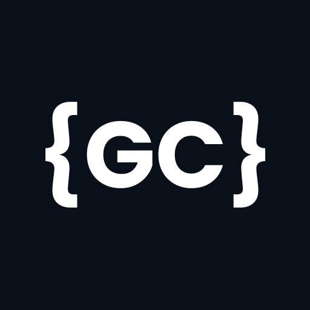

  

  <h1>Gabriel Cavalcanti · Portfólio</h1>

  
<strong>Desenvolvimento Full Stack · Interfaces, APIs e soluções digitais</strong>

  
Meu espaço para apresentar projetos, trajetória profissional, habilidades e serviços.

  

    <a href="https://gabrielcavalcantidev.com/">Acessar o site</a> ·
    <a href="https://www.linkedin.com/in/gabrielmoc/">LinkedIn</a> ·
    <a href="mailto:gabrielmoc2010@gmail.com">Entrar em contato</a>
  

  

    
    
    
    
  

  
🇧🇷 Português · 🇺🇸 English · 🇪🇸 Español

---

## Sobre o projeto

Este repositório contém o código do meu portfólio profissional: uma aplicação React com TypeScript, navegação por seções e publicação como site estático. O objetivo é reunir minha experiência em desenvolvimento, apresentar soluções que construí e facilitar o contato para novos projetos.

A interface combina uma identidade visual em tons de azul, suporte a telas menores e recursos de navegação que ajudam a explorar o conteúdo.

## Funcionalidades

- **Apresentação pessoal:** hero com foto, acesso aos projetos e currículo em PDF.
- **Fundo interativo:** partículas desenhadas em Canvas que reagem ao cursor, acompanhadas de iluminação e animações sutis.
- **Busca rápida:** pesquisa de seções, projetos e tecnologias pela lupa ou pelo atalho `Ctrl + K` / `⌘ + K`, ignorando diferenças de acentuação e maiúsculas.
- **Três idiomas:** português brasileiro, inglês e espanhol, com preferência salva em `localStorage` e atualização do idioma do documento, título e descrição da página.
- **Temas claro e escuro:** alternância pelo cabeçalho, com tema escuro como estado inicial.
- **Trajetória profissional:** abas de tecnologias, experiência, formação e cursos/projetos complementares.
- **Catálogo de projetos:** imagens, descrições, tecnologias utilizadas e links para as aplicações.
- **Serviços e contato:** apresentação dos serviços, formulário, WhatsApp e redes sociais.
- **Movimento reduzido:** respeito à preferência `prefers-reduced-motion`; o loop de animação do Canvas é suspenso quando a hero sai da área visível ou a aba fica oculta.

> O formulário usa um endpoint PHP e SMTP autenticado para enviar mensagens sem sair do site. A ativação exige configurar as credenciais no servidor, fora da pasta pública. Consulte o [guia de configuração do formulário](docs/FORMULARIO-CONTATO.md).

## Tecnologias

| Camada | Tecnologias | Uso no portfólio |
| --- | --- | --- |
| Interface | React 18 + TypeScript | Componentes, estado e tipagem |
| Desenvolvimento e build | Vite 5 + SWC | Servidor local e geração dos arquivos de produção |
| Estilização | Tailwind CSS 3 + CSS | Layout responsivo, temas e animações |
| Componentes de interface | shadcn/ui + Radix UI | Botões, abas, menus, diálogos e outros elementos |
| Ícones | Lucide React | Iconografia da navegação e das seções |
| Navegação | React Router DOM | Rota principal e página de rota não encontrada |
| Pesquisa | cmdk + filtragem local | Interface de busca e seleção de resultados |
| Internacionalização | React Context + JSON | Traduções e gerenciamento do idioma |
| Animação | Canvas 2D + APIs do navegador | Partículas, interação com o cursor e controle de visibilidade |
| Análise estática | ESLint + TypeScript | Verificação de código e tipos |

As tecnologias citadas nos cards, como Django, PostgreSQL, Go, WordPress e Stripe, pertencem aos projetos apresentados. Não são dependências necessárias para executar este portfólio.

## Autor

**Gabriel Moura de Oliveira Cavalcanti** — Desenvolvedor Full Stack, Recife/PE.

- **Portfólio:** [gabrielcavalcantidev.com](https://gabrielcavalcantidev.com/)
- **GitHub:** [@gabrielmoc](https://github.com/gabrielmoc)
- **LinkedIn:** [gabrielmoc](https://www.linkedin.com/in/gabrielmoc/)
- **E-mail:** [gabrielmoc2010@gmail.com](mailto:gabrielmoc2010@gmail.com)
